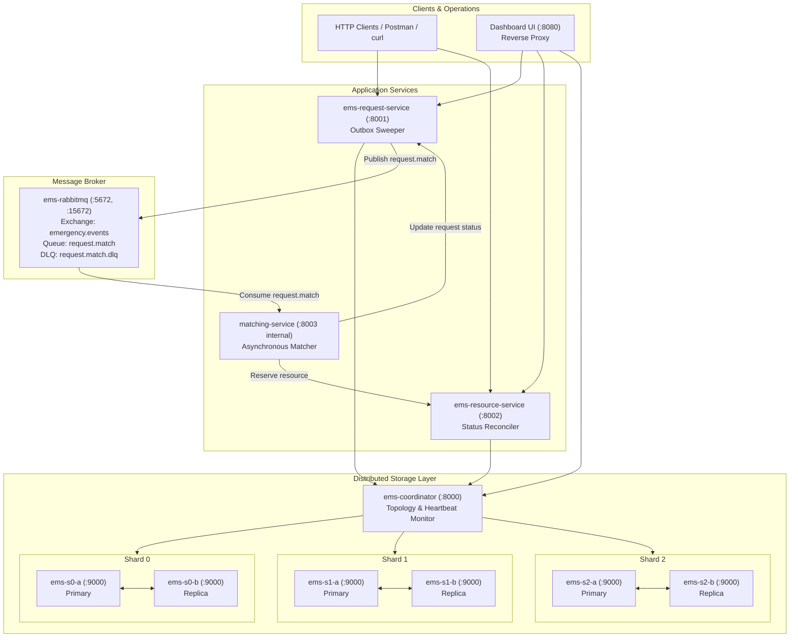

# Distributed Emergency Resource Matching System (EMS)

A distributed, fault-tolerant emergency resource matching platform designed to connect people in need with nearby available resources during crisis situations.

The system uses a microservices architecture, horizontally partitioned storage, asynchronous messaging via RabbitMQ, primary-replica data replication with epoch-based fencing, and container orchestration across Docker Compose and Kubernetes.

---

## 1. Overview

During emergencies such as floods, earthquakes, or industrial incidents, affected populations require essential relief supplies: drinking water, food packets, medical supplies, emergency shelter, and evacuation transportation.

The **Emergency Resource Matching System (EMS)** provides:
- Direct REST intake APIs for citizen emergency requests and organizational resource inventory.
- Deterministic horizontal partitioning across 3 logical storage shards via SHA-256 key hashing without exposing internal storage topology to clients.
- Semi-synchronous primary-replica replication with automated failure detection and monotonic epoch fencing.
- Asynchronous matching workers decoupled by RabbitMQ with at-least-once delivery, transactional outbox pattern, and dead-letter queue isolation.
- Concurrent and atomic resource reservation preventing double allocation under load.
- Reproducible deployment on Docker Compose (12 containers) and local Kubernetes (Minikube 5 GB).

---

## 2. System Architecture

### 2.1 Architecture Diagram



### 2.2 System Components

The Docker Compose environment runs 12 containers:

| Container Name | Service Name | Exposed / Internal Ports | Purpose |
|---|---|---|---|
| `ems-coordinator` | `coordinator` | `8000:8000` | Manages shard routing tables, monitors heartbeats, coordinates failover |
| `ems-request-service` | `request-service` | `8001:8001` | Handles request creation, status queries, and transactional outbox publishing |
| `ems-resource-service` | `resource-service` | `8002:8002` | Manages resource inventory, status updates, and optimistic lock reservations |
| `emergency-matching-matching-service-1` | `matching-service` | `8003` (internal) | Consumes matching events from RabbitMQ and pairs nearest resources |
| `ems-rabbitmq` | `rabbitmq` | `5672` (AMQP), `15672:15672` (Admin) | Direct durable exchange, retry queues, and dead-letter quarantine |
| `ems-s0-a` | `s0-a` | `9000` (internal) | Shard 0 Primary storage node (SQLite engine in WAL mode) |
| `ems-s0-b` | `s0-b` | `9000` (internal) | Shard 0 Replica storage node |
| `ems-s1-a` | `s1-a` | `9000` (internal) | Shard 1 Primary storage node |
| `ems-s1-b` | `s1-b` | `9000` (internal) | Shard 1 Replica storage node |
| `ems-s2-a` | `s2-a` | `9000` (internal) | Shard 2 Primary storage node |
| `ems-s2-b` | `s2-b` | `9000` (internal) | Shard 2 Replica storage node |
| `ems-dashboard` | `dashboard` | `8080:80` | Nginx reverse proxy serving the operational monitoring web dashboard |

---

## 3. Distributed Storage, Sharding, and Replication

### 3.1 Hash Sharding Function
Storage keys follow the schema `request:{uuid}` and `resource:{uuid}`. Partitioning is computed deterministically in [`common/ems_common/sharding.py`](common/ems_common/sharding.py) using the first 8 bytes of the SHA-256 digest:

```python
def shard_of(key: str, n_shards: int = 3) -> int:
    digest = hashlib.sha256(key.encode("utf-8")).digest()
    return int.from_bytes(digest[:8], "big") % n_shards
```

Clients communicate only with the coordinator (`http://coordinator:8000`). The coordinator looks up the active primary for `shard_of(key)` in its in-memory routing table and forwards the request. Clients never interact directly with individual storage node addresses.

### 3.2 Replication and Monotonic Oplog
Each storage node maintains an independent SQLite database operating in WAL mode. Primary nodes write updates to an append-only operation log (`oplog`):
- `seq`: Monotonically increasing sequence number.
- `op`: Operation type (`PUT` or `DELETE`).
- `key`: Record identifier.
- `val_json`: Full serialized JSON payload.
- `version`: Version counter for optimistic locking.
- `epoch`: Current fencing epoch.

The primary replicates every oplog entry to its paired replica via `POST /internal/sync` before acknowledging successful writes.

### 3.3 Heartbeat and Failover Thresholds
Thresholds configured in [`docker-compose.yml`](docker-compose.yml) and [`services/coordinator/coordinator/health_checker.py`](services/coordinator/coordinator/health_checker.py):
- `HEARTBEAT_INTERVAL_SEC`: `2.0` seconds between storage node heartbeats.
- `MISSED_HEARTBEATS_LIMIT`: `3` intervals without a heartbeat ($3 \times 2.0 = 6.0$ seconds) before triggering a direct probe.
- `probe_timeout_sec`: `1.0` second for active coordinator probe. If unreachable, the node is marked `DOWN`.
- `HEALTH_CHECK_INTERVAL_SEC`: `1.0` second check interval in the coordinator background thread.

### 3.4 Epoch Fencing and Measured Failover Timings
To prevent stale primaries from writing after network interruptions or pauses, the coordinator tracks a monotonic `epoch` for each shard:
1. When a primary fails, the coordinator increments the shard epoch ($E \rightarrow E+1$) and promotes the replica via `POST /internal/role`.
2. Any subsequent write from the old primary carrying an older epoch is rejected by storage nodes with HTTP `409 Conflict` (`STALE_EPOCH`).

**Measured Failover Timings from Evidence Files**:
- In [`docs/evidence/stage8/storage_failure_outage/coordinator.log`](docs/evidence/stage8/storage_failure_outage/coordinator.log):
  - Node `s1-a` marked DOWN: `2026-11-23T15:30:01.205143+00:00` (`ageSec: 6.852s`).
  - Promotion RPC to `s1-b` completed: `2026-11-23T15:30:01.221370+00:00`.
  - Failover logged with epoch 4: `2026-11-23T15:30:01.222116+00:00` (~17 milliseconds from DOWN detection to promotion).
- In [`docs/evidence/stage5/live_drill_output.txt`](docs/evidence/stage5/live_drill_output.txt):
  - Injected primary failure during 10 req/s load.
  - HTTP `503` returned from `[15s]` to `[20s]` (a 6-second window matching 3 missed heartbeats).
  - Normal traffic resumed at `[21s]`.
  - Summary: Total acknowledged keys: 528; verified readable: 528; retries: 55; lost keys: 0.

---

## 4. Asynchronous Messaging & Transactional Outbox

### 4.1 Transactional Outbox Pattern
To prevent message loss if the message broker is temporarily unreachable during request creation:
1. `POST /requests` persists the record in SQLite via the coordinator with database field `eventPending: true`.
2. The request service attempts immediate publishing to RabbitMQ with publisher confirmations.
3. Upon broker confirmation, `eventPending` is set to `false`, and the response returns `matchQueued: true`.
4. If RabbitMQ is down, the request still succeeds with `201 Created` (`matchQueued: false`).
5. A background sweeper thread ([`services/request-service/request_service/sweeper.py`](services/request-service/request_service/sweeper.py)) runs every `SWEEP_INTERVAL_SEC: 15.0` to scan for records with `eventPending: true` older than `SWEEP_GRACE_SEC: 10.0` and republishes them with confirms.

### 4.2 RabbitMQ Topology
Defined in [`common/ems_common/rabbit.py`](common/ems_common/rabbit.py):
- **Direct Exchange**: `emergency.events` (durable).
- **Matching Queue**: `request.match` bound to `emergency.events` with routing key `request.match`.
- **Retry Exchange**: `emergency.retry` (direct, durable).
- **Retry Queue**: `request.match.retry` with TTL (`5000` ms), dead-lettering back to `emergency.events`.
- **Dead-Letter Queue (DLQ)**: `request.match.dlq` bound to `emergency.dlx` with routing key `request.match`.
- Messages exceeding `MAX_RETRIES: 3` are routed to `request.match.dlq` for operator inspection.

---

## 5. Resource Matching Algorithm & Concurrency

### 5.1 Matching Logic
The matching worker in [`services/matching-service/matching_service/matcher.py`](services/matching-service/matching_service/matcher.py):
1. Verifies the request is in `PENDING` status.
2. Queries `resource-service` for resources matching the requested `type` with `availability: true` and `status: AVAILABLE`.
3. Computes the distance between request and resource coordinates using the geodesic **Haversine formula**:
   $$d = 2R \arcsin \left(\sqrt{\sin^2\left(\frac{\Delta \text{lat}}{2}\right) + \cos(\text{lat}_1)\cos(\text{lat}_2)\sin^2\left(\frac{\Delta \text{lon}}{2}\right)}\right)$$
   where $R = 6371.0\text{ km}$.
4. Selects the nearest eligible candidate.
5. Deterministically breaks distance ties by comparing the string representation of `resourceId`.
6. **Maximum Match Distance**: `MAX_MATCH_DISTANCE_KM` is unset by default in the environment, meaning there is no maximum distance limit unless explicitly specified.

### 5.2 Atomic Reservation
To avoid double allocation during concurrent worker execution:
1. `resource-service` maintains an integer `version` field on each resource record.
2. The matching worker sends `PUT /resources/{id}/status` with `ifVersion: <int>` and status `ASSIGNED`.
3. If two workers attempt to reserve the same resource version, SQLite executes an atomic compare-and-swap: one worker receives `200 OK`, while the other receives `409 Conflict` (`VERSION_MISMATCH`).
4. In [`tests/integration/test_stage7_concurrency.py`](tests/integration/test_stage7_concurrency.py), 50 simultaneous requests competing for 5 available resources resulted in exactly 5 assignments and 45 `NO_MATCH` outcomes with zero duplicate reservations.

---

## 6. Public REST API Reference

Direct URLs on `request-service` (`:8001`) and `resource-service` (`:8002`):

| Method | URL | Payload Example | Success Code | Error Codes | Description |
|---|---|---|---|---|---|
| `POST` | `http://localhost:8001/requests` | `{"type":"water","location":{"lat":12.97,"lon":77.59},"details":"..."}` | `201 Created` | `400`, `503` | Creates request (`PENDING`) and enqueues outbox event |
| `GET` | `http://localhost:8001/requests/{id}` | None | `200 OK` | `400`, `404`, `503` | Retrieves request record by UUID |
| `PUT` | `http://localhost:8001/requests/{id}/status` | `{"status":"IN_PROGRESS"}` | `200 OK` | `400`, `404`, `409`, `503` | Updates status; enforces state transition rules |
| `POST` | `http://localhost:8001/match/{id}` | None | `200 OK` | `400`, `404`, `503` | Re-queues a request for matching (e.g., after `NO_MATCH`) |
| `GET` | `http://localhost:8001/requests` | Optional query: `?type=water&status=PENDING` | `200 OK` | `400`, `503` | Lists requests across all shards |
| `POST` | `http://localhost:8002/resources` | `{"type":"water","location":{"lat":12.97,"lon":77.59},"availability":true}` | `201 Created` | `400`, `503` | Registers resource with status `AVAILABLE`, version `1` |
| `GET` | `http://localhost:8002/resources/{id}` | None | `200 OK` | `400`, `404`, `503` | Retrieves resource record by UUID |
| `PUT` | `http://localhost:8002/resources/{id}/status` | `{"status":"OFFLINE"}` | `200 OK` | `400`, `404`, `409`, `503` | Updates resource status; direct `ASSIGNED` blocked (`409`) |
| `GET` | `http://localhost:8002/resources` | Optional query: `?type=water&status=AVAILABLE` | `200 OK` | `400`, `503` | Lists resources across all shards |

---

## 7. Operations Dashboard Guide

The web dashboard is hosted at `http://localhost:8080`:
- **Nginx Reverse Proxy Paths**:
  - `/api/coord/` proxies to `http://coordinator:8000/`
  - `/api/req/` proxies to `http://request-service:8001/`
  - `/api/res/` proxies to `http://resource-service:8002/`
- **Frontend Value Normalization**:
  - The UI uses vanilla JavaScript in [`dashboard/js/`](dashboard/js/).
  - Wire requests sent by `dashboard/js/api.js` explicitly convert types to lowercase (`payload.type.toLowerCase()`), matching backend Pydantic models (`water`, `food`, `medicine`, `shelter`, `transportation`).
- **Features**:
  - Cluster topology: Shard health matrix, node roles, epochs, and oplog sequence numbers.
  - Emergency requests: Submit requests and observe matching status in real time.
  - Resources: Register assets and toggle availability status.

---

## 8. Verification, Testing, and Demonstrations

### 8.1 Automated Test Suites and Real Test Counts
Test suites are executed using `make` targets. The real counts verified in the repository are:

| Command | Pytest Selector | Verified Result | Execution Time | Purpose |
|---|---|---|---|---|
| `make test` | `-m "unit or component"` | **238 passed**, 56 deselected | 87.06s | In-memory unit tests, routing, and component tests |
| `make itest` | `-m "integration"` | **27 passed**, 263 deselected | 159.72s | End-to-end API tests against Docker Compose stack |
| `make ftest` | `-m "fault"` | **16 passed**, 274 deselected | 393.45s | Fault-injection, failover drills, and recovery tests |
| `make all-tests` | Full suite runner | **281 passed** across tiers | ~640s | Complete automated test regression |

### 8.2 Demonstration Scripts
Demonstration walkthroughs in [`scripts/demo/`](scripts/demo/):

| Script Path | Purpose |
|---|---|
| [`scripts/demo/demo_01_request.sh`](scripts/demo/demo_01_request.sh) | Scenario 1: Create, retrieve, and validate emergency requests |
| [`scripts/demo/demo_02_resource.sh`](scripts/demo/demo_02_resource.sh) | Scenario 2: Register resources and query with filters |
| [`scripts/demo/demo_03_matching.sh`](scripts/demo/demo_03_matching.sh) | Scenario 3: Verify nearest-resource matching via Haversine distance |
| [`scripts/demo/demo_04_distribution.sh`](scripts/demo/demo_04_distribution.sh) | Scenario 4: Verify SHA-256 key distribution across shards 0, 1, and 2 |
| [`scripts/demo/demo_05_async.sh`](scripts/demo/demo_05_async.sh) | Scenario 5: Submit request with broker stopped, then resume matching |
| [`scripts/demo/demo_06_storage_failure.sh`](scripts/demo/demo_06_storage_failure.sh) | Scenario 6: Stop primary storage node and observe failover to replica |
| [`scripts/demo/demo_07_node_recovery.sh`](scripts/demo/demo_07_node_recovery.sh) | Scenario 7: Restart old primary and verify oplog catch-up and rejoin |
| [`scripts/demo/demo_08_k8s_recovery.sh`](scripts/demo/demo_08_k8s_recovery.sh) | Scenario 8: Delete Kubernetes pod and observe automatic replacement |
| [`scripts/demo/demo_09_k8s_scaling.sh`](scripts/demo/demo_09_k8s_scaling.sh) | Scenario 9: Scale matching worker Deployment from 1 to 3 replicas |

---

## 9. Runbook and Execution Instructions

### 9.1 Prerequisites
- Python 3.11+
- Docker and Docker Compose V2
- GNU Make
- Minikube and `kubectl` (for Kubernetes execution)
- Development Credentials:
  - RabbitMQ: `ems` / `ems-dev-password` (dev only, specified in `.env.example` and `docker-compose.yml`)

### 9.2 Docker Compose Execution
```bash
# 1. Start the 12-container stack and wait for healthchecks
docker compose up -d --wait

# 2. Check cluster shard diagnostics
curl -s http://localhost:8000/diagnostics/shards | python -m json.tool

# 3. Run integration tests against the live stack
make itest

# 4. Access the web dashboard
# Open http://localhost:8080 in your browser

# 5. Stop the stack
docker compose down
```

### 9.3 Kubernetes Execution
Workloads are managed via manifests in [`k8s/`](k8s/):
```bash
# 1. Start Minikube with required 5 GB memory allocation
minikube start --memory=5120 --cpus=2

# 2. Deploy namespace, secrets, statefulsets, and deployments
bash scripts/k8s/k8s_up.sh

# 3. Run automated Stage 9 verification script
python3 scripts/k8s/k8s_verify_stage9.py

# 4. Teardown
bash scripts/k8s/k8s_down.sh
```

### 9.4 Postman API Collection
API test definitions are in [`postman/`](postman/):
- Collection: [`postman/ems.postman_collection.json`](postman/ems.postman_collection.json) (13 requests with `pm.test` assertions).
- Environment: [`postman/ems.postman_environment.json`](postman/ems.postman_environment.json).
- Executed run evidence: [`docs/evidence/postman/run-1.json`](docs/evidence/postman/run-1.json).

---

## 10. Documented Limitations (SPEC 16.2)

In accordance with specification guidelines:

1. **Single Coordinator**: The coordinator is a centralized routing directory and single point of failure. Although shard state is saved to disk (`shard_state.json`) and reconstructed on restart, the coordinator does not run as a replicated high-availability cluster.
2. **Absence of Distributed Quorum Protocol**: The system uses primary-replica replication, SQLite WAL mode, and coordinator epochs. No multi-node quorum or distributed election protocol is implemented. Network-partition tolerance across complex splits is not guaranteed.
3. **Static Sharding**: Keys are partitioned via fixed `mod 3` arithmetic. Dynamic shard splits and key rebalancing when adding shards are not implemented.
4. **Single Failure Assumption**: Each shard tolerates the failure of at most one node. If both primary and replica in a shard fail simultaneously, that shard returns HTTP `503 Service Unavailable`.
5. **Divergent Tail Discard**: If a partitioned primary accepts writes that were not replicated before it failed, those unreplicated writes are overwritten during snapshot recovery when the node rejoins.
6. **No Authentication or Encryption**: Internal and public HTTP endpoints do not implement authentication, role-based authorization, or TLS encryption; these are designated out of scope in SPEC 16.2.

---

## 11. Requirements Coverage Matrix

| Requirement Area | Specification IDs | Verified Implementation | Test & Demonstration Proof |
|---|---|---|---|
| Emergency Intake & API | FR-1, FR-4, FR-5, FR-6, FR-7, FR-8 | `services/request-service/` | `tests/unit/test_request_service.py`, [`docs/evidence/01-request-create-retrieve/`](docs/evidence/01-request-create-retrieve/) |
| Resource Management | FR-2, FR-4, FR-6, FR-7 | `services/resource-service/` | `tests/unit/test_resource_service.py`, [`docs/evidence/02-resource-registration/`](docs/evidence/02-resource-registration/) |
| Nearest Matching | FR-3, MR-3 | `services/matching-service/` | `tests/unit/test_matching_logic.py`, [`docs/evidence/03-resource-matching/`](docs/evidence/03-resource-matching/) |
| Hash Partitioning | SR-1, SR-2, SR-3, SR-4, SR-5 | `common/ems_common/sharding.py` | `tests/unit/test_sharding.py`, [`docs/evidence/04-data-distribution/`](docs/evidence/04-data-distribution/) |
| Asynchronous Messaging | MR-1, MR-2 | `common/ems_common/rabbit.py` | `tests/fault/test_stage7_messaging.py`, [`docs/evidence/05-async-processing/`](docs/evidence/05-async-processing/) |
| Concurrency Safety | TS-1 | `resource_service/main.py` | `tests/integration/test_stage7_concurrency.py`, [`docs/evidence/09-k8s-scaling/`](docs/evidence/09-k8s-scaling/) |
| Failover & Fencing | FT-1, FT-2, FT-3, FT-4, FT-5 | `services/coordinator/` | `tests/fault/test_stage5_failover.py`, [`docs/evidence/06-storage-failure/`](docs/evidence/06-storage-failure/) |
| Containerization | DK-1 | `docker-compose.yml` | `scripts/verify/test_fresh_clone.sh`, [`docs/evidence/tests/test_fresh_clone.txt`](docs/evidence/tests/test_fresh_clone.txt) |
| Kubernetes Lifecycle | K8-1, K8-2, K8-3 | `k8s/*.yaml`, `scripts/k8s/` | `scripts/k8s/k8s_verify_stage9.py`, [`docs/evidence/stage9/`](docs/evidence/stage9/) |
