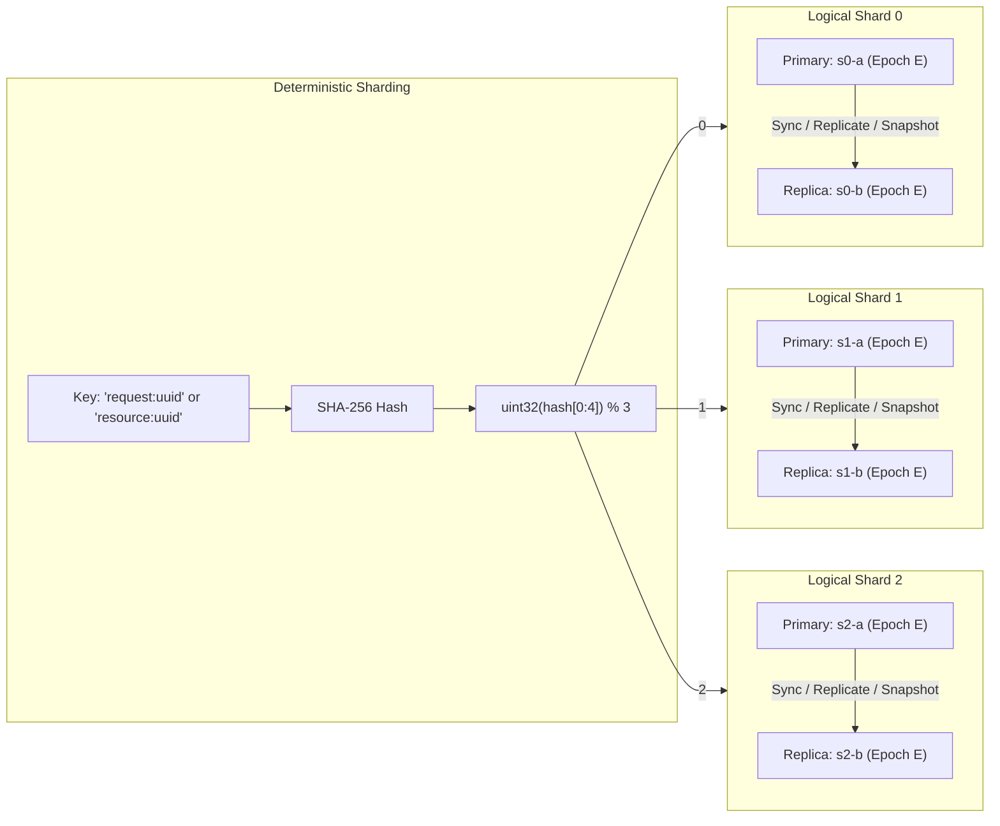
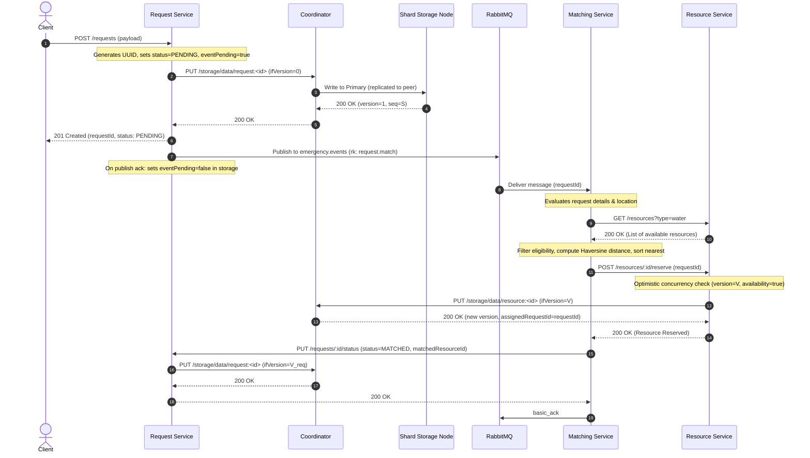
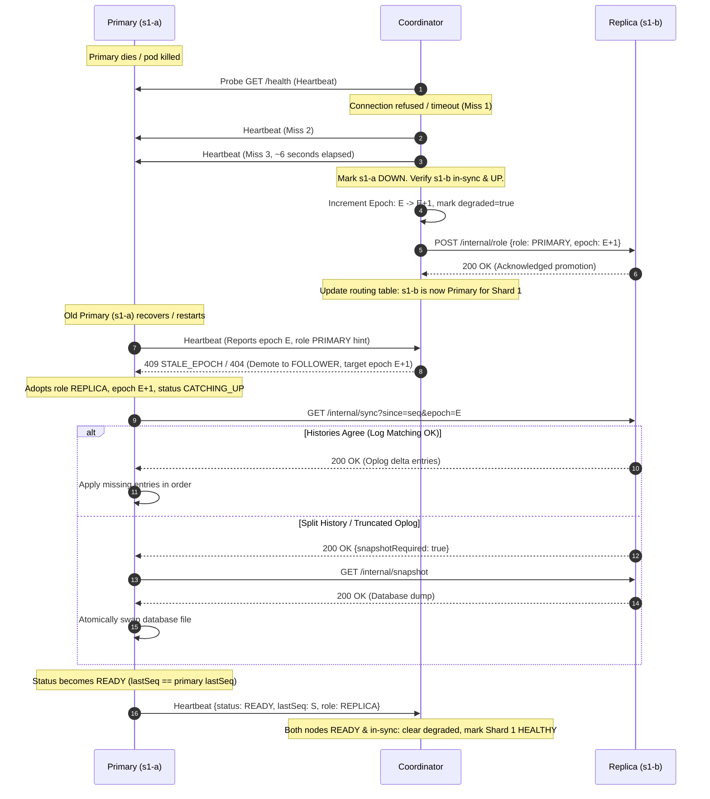

# System Architecture: Distributed Emergency Resource Matching System (EMS)

The Emergency Resource Matching System (EMS) is a resilient, horizontally partitioned, asynchronous microservice platform designed to coordinate disaster response requests with available emergency resources under high concurrency, node failures, and network volatility.

---

## 1. High-Level System Architecture

The system comprises three user-facing application services, a central coordinator, a 3-shard replicated custom storage engine (6 storage nodes), and RabbitMQ message broker.

```mermaid
graph TD
    Client(["Clients & External Callers"])

    subgraph EdgeServices["Application Services Layer"]
        REQ["Request Service<br/>(Port 8001)"]
        RES["Resource Service<br/>(Port 8002)"]
        MATCH["Matching Service<br/>(Port 8003, Scalable 1..3)"]
    end

    subgraph Messaging["Message Broker"]
        RMQ[("RabbitMQ<br/>(emergency.events / request.match)")]
    end

    subgraph StorageControl["Routing & Coordination Layer"]
        COORD["Coordinator<br/>(Port 8000 / Shard Diagnostics)"]
    end

    subgraph Shards["Distributed Replicated Storage Engine (SHA-256 Partitioning)"]
        subgraph Shard0["Shard 0 (mod 3 = 0)"]
            S0A[("s0-a<br/>(Primary/Replica)")]
            S0B[("s0-b<br/>(Primary/Replica)")]
        end
        subgraph Shard1["Shard 1 (mod 3 = 1)"]
            S1A[("s1-a<br/>(Primary/Replica)")]
            S1B[("s1-b<br/>(Primary/Replica)")]
        end
        subgraph Shard2["Shard 2 (mod 3 = 2)"]
            S2A[("s2-a<br/>(Primary/Replica)")]
            S2B[("s2-b<br/>(Primary/Replica)")]
        end
    end

    Client -->|POST /requests<br/>GET /requests| REQ
    Client -->|POST /resources<br/>GET /resources| RES
    Client -->|POST /match/:id| REQ

    REQ -->|Publish request.created| RMQ
    RMQ -->|Consume request.match| MATCH

    MATCH -->|GET /resources (Find candidates)| RES
    MATCH -->|POST /resources/:id/reserve| RES
    MATCH -->|PUT /requests/:id/status| REQ

    REQ -->|Route key: request:id| COORD
    RES -->|Route key: resource:id| COORD

    COORD -.->|Forward read/write| S0A
    COORD -.->|Forward read/write| S1A
    COORD -.->|Forward read/write| S2A

    S0A <===>|Replication & Sync| S0B
    S1A <===>|Replication & Sync| S1B
    S2A <===>|Replication & Sync| S2B
```

---

## 2. Sharding and Storage Replication Topology

The storage engine implements 3 logical shards. Partitioning is determined deterministically via SHA-256:
$$\text{shardId} = \text{uint32}(\text{sha256}(\text{key})[:4]) \pmod 3$$



---

## 3. End-to-End Sequence Diagrams

### 3.1 Flow A & B: Request Creation, Asynchronous Queuing, and Resource Matching



### 3.2 Failure, Heartbeat Loss, Promotion, and Recovery Sequence



---

## 4. Architectural Flows (A through D)

### Flow A: Request Creation and Outbox Safety
1. Caller submits `POST /requests`.
2. The Request Service generates a UUID, assigns status `PENDING`, sets `eventPending: true`, and writes the record through the Coordinator to the primary storage node via optimistic concurrency (`ifVersion: 0`).
3. Once the storage write succeeds, HTTP `201 Created` is returned to the client.
4. The Request Service publishes the `request.match` event to RabbitMQ exchange `emergency.events`. Upon broker acknowledgement, it updates `eventPending: false`.

### Flow B: Matching and Atomic Reservation
1. A Matching Service worker consumes an event from queue `request.match`.
2. It fetches candidate resources from the Resource Service (`GET /resources?type=<type>`).
3. Candidates are filtered for `status: AVAILABLE` and `availability: true`.
4. Distances are computed using the Haversine formula. The closest candidate is selected; ties are broken by resource ID ascending.
5. The worker attempts atomic reservation via `POST /resources/<id>/reserve`. The Resource Service uses optimistic concurrency (`ifVersion`).
   - If `409 VersionConflict`, another worker reserved the resource; the matcher retries with the next nearest candidate.
   - If no candidates remain, the request transitions to `NO_MATCH`.
6. Once reserved, the worker transitions the request to `MATCHED` with `matchedResourceId` and acknowledges the RabbitMQ message.

### Flow C: Outbox Sweeper Fallback
If the RabbitMQ broker is unreachable when a request is created, the request is safely persisted with `eventPending: true`. A background outbox sweeper thread periodically scans requests with `eventPending: true` and republishes them once broker connectivity is restored, guaranteeing at-least-once delivery.

### Flow D: Storage Replication, Degraded Writes, and Catch-up Sync
1. Normal writes route through the Primary. The Primary executes the write, increments sequence number `lastSeq`, and sends `POST /internal/replicate` to the peer replica.
2. If the replica is unreachable or fails to acknowledge within `REPLICATION_TIMEOUT_SEC`:
   - The Primary reports degraded state to the Coordinator: `POST /internal/nodes/degraded`.
   - The write is acknowledged with `replicated: false`.
   - The Coordinator marks the shard as `DEGRADED`.
3. When the offline replica recovers:
   - It issues `GET /internal/sync` to the primary.
   - Missing oplog entries are applied in sequence until `lastSeq == primary.lastSeq`.
   - The replica marks itself `READY`. On the next heartbeat cycle, the Coordinator restores shard state to `HEALTHY`.

---

## 5. Data Model & State Transitions

### Key Schema
All state is partitioned across shards using namespaced keys:
- Requests: `request:<uuid>`
- Resources: `resource:<uuid>`

### Request Lifecycle Finite State Machine
- `PENDING` $\rightarrow$ `MATCHED` (Successfully matched and reserved)
- `PENDING` $\rightarrow$ `NO_MATCH` (No available resource found)
- `PENDING` $\rightarrow$ `CANCELLED` (Cancelled by user/operator)
- `MATCHED` $\rightarrow$ `FULFILLED` (Resource arrived/incident resolved)
- `MATCHED` $\rightarrow$ `CANCELLED` (Incident aborted; associated resource released)
- `NO_MATCH` $\rightarrow$ `PENDING` (Retried manually via `POST /match/:id` or on new resource addition)

### Resource Lifecycle Finite State Machine
- `AVAILABLE` $\rightarrow$ `ASSIGNED` (Reserved atomically for a request; `availability: false`)
- `ASSIGNED` $\rightarrow$ `AVAILABLE` (Released upon fulfillment or request cancellation)
- `AVAILABLE` $\rightarrow$ `MAINTENANCE` (Temporarily taken offline)
- `MAINTENANCE` $\rightarrow$ `AVAILABLE` (Returned to service)

---

## 6. RabbitMQ Topology & Dead Lettering

| Entity | Name | Type | Durable | Configuration |
|---|---|---|---|---|
| Exchange | `emergency.events` | `direct` | Yes | Primary event bus |
| Queue | `request.match` | `quorum`/`classic` | Yes | Bound to `emergency.events` with routing key `request.match`. DLX: `emergency.retry` |
| Exchange | `emergency.retry` | `direct` | Yes | Retry exchange |
| Queue | `request.match.retry` | `classic` | Yes | `x-message-ttl: 5000`, DLX: `emergency.events`, routing key: `request.match` |
| Exchange | `emergency.dlx` | `direct` | Yes | Dead letter exchange for poison pills |
| Queue | `request.match.dlq` | `classic` | Yes | Bound to `emergency.dlx` after 3 failed retries |
