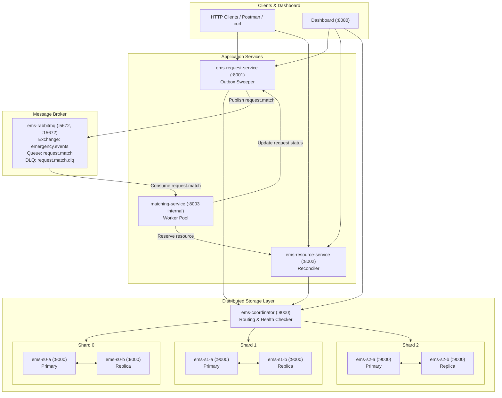

# Emergency Resource Matching System (EMS): Design & Engineering Report

**Course / Project**: Distributed Systems Project  
**System**: Distributed Emergency Resource Matching System (EMS)  
**Specification Version**: 1.0 (SPEC 15.1 & SPEC 16.2)

---

## 1. System Overview

In disaster relief and emergency response operations, time-sensitive demands for essential relief items (drinking water, food packets, medical kits, temporary shelter, and emergency evacuation transport) must be matched reliably against available volunteer and organizational supplies.

The **Emergency Resource Matching System (EMS)** is an asynchronous, horizontally partitioned microservice application designed to address these requirements. Key system capabilities include:

1. **Direct REST APIs**: Stateless endpoints for citizen emergency intake (`request-service`) and physical asset inventory management (`resource-service`).
2. **Deterministic Partitioning**: Uniform data distribution across 3 storage shards via SHA-256 key hashing without exposing physical storage node addresses to API clients.
3. **Primary-Replica High Availability**: Semi-synchronous SQLite operation log replication, heartbeat-based failure detection, and epoch-fenced failover.
4. **Asynchronous Matching & Transactional Outbox**: RabbitMQ message pipeline using an `eventPending` database flag and background sweeper, dead-letter quarantine (`request.match.dlq`), and atomic version-checked resource reservation preventing double allocation.
5. **Dual Deployment Topologies**: Containerized execution under Docker Compose (12 containers) and local Kubernetes orchestration (Minikube 5 GB).

---

## 2. Architecture & Components

### 2.1 Architecture Diagram



### 2.2 System Components

The Docker Compose deployment runs 12 containers:

| Container Name | Service Name | Exposed / Internal Ports | Purpose |
|---|---|---|---|
| `ems-coordinator` | `coordinator` | `8000:8000` | Shard routing directory, heartbeat monitoring, and automated failover |
| `ems-request-service` | `request-service` | `8001:8001` | Request intake, status transitions, and outbox sweeper publisher |
| `ems-resource-service` | `resource-service` | `8002:8002` | Resource inventory, Haversine scan retrieval, and optimistic locking |
| `emergency-matching-matching-service-1` | `matching-service` | `8003` (internal) | Asynchronous matching worker consuming `request.match` events |
| `ems-rabbitmq` | `rabbitmq` | `5672` (AMQP), `15672:15672` (Admin) | Message broker with direct exchange, retry queue, and dead-letter queue |
| `ems-s0-a` | `s0-a` | `9000` (internal) | Shard 0 Primary storage node (SQLite WAL engine) |
| `ems-s0-b` | `s0-b` | `9000` (internal) | Shard 0 Replica storage node |
| `ems-s1-a` | `s1-a` | `9000` (internal) | Shard 1 Primary storage node |
| `ems-s1-b` | `s1-b` | `9000` (internal) | Shard 1 Replica storage node |
| `ems-s2-a` | `s2-a` | `9000` (internal) | Shard 2 Primary storage node |
| `ems-s2-b` | `s2-b` | `9000` (internal) | Shard 2 Replica storage node |
| `ems-dashboard` | `dashboard` | `8080:80` | Nginx reverse proxy serving the operations room UI |

---

## 3. Storage, Sharding, and Replication Design

### 3.1 Hash Sharding Function
Storage keys follow the prefix format `request:{uuid}` and `resource:{uuid}`. Partitioning is computed deterministically in `common/ems_common/sharding.py` via the first 8 bytes of the SHA-256 digest:

```python
def shard_of(key: str, n_shards: int = 3) -> int:
    digest = hashlib.sha256(key.encode("utf-8")).digest()
    return int.from_bytes(digest[:8], "big") % n_shards
```

Clients interact exclusively through the Coordinator (`http://coordinator:8000`), which evaluates `shard_of(key)` and proxies the HTTP request to the designated active primary node. API callers never connect directly to storage node network addresses.

### 3.2 Replication and Monotonic Oplog
Each storage node manages an independent SQLite database in Write-Ahead Logging (`WAL`) mode. Primary nodes record all state mutations in an append-only operation log table (`oplog`):
- `seq`: Monotonically increasing 64-bit integer.
- `op`: Operation type (`PUT` or `DELETE`).
- `key`: Domain record key.
- `val_json`: Complete JSON payload.
- `version`: Optimistic lock version counter.
- `epoch`: Primary fencing generation number.

When serving writes, the primary writes to SQLite and immediately replicates the oplog entry to its paired replica via `POST /internal/sync` before acknowledging the coordinator.

### 3.3 Heartbeat Thresholds & Failover Mechanics
Storage node health and failover thresholds are defined in `docker-compose.yml` and `services/coordinator/coordinator/health_checker.py`:
- `HEARTBEAT_INTERVAL_SEC`: `2.0` seconds. Storage nodes send `POST /internal/nodes/heartbeat` to the coordinator.
- `MISSED_HEARTBEATS_LIMIT`: `3`. If no heartbeat is received for $3 \times 2.0 = 6.0$ seconds, the coordinator initiates an active HTTP probe.
- `probe_timeout_sec`: `1.0` second. If the direct probe fails, the coordinator marks the node `DOWN`.
- `HEALTH_CHECK_INTERVAL_SEC`: `1.0` second background loop in coordinator.

### 3.4 Epoch Fencing and Measured Failover Timings
To prevent stale primaries from writing after partition or pause, the coordinator maintains a monotonic `epoch` counter per shard. Upon detecting a primary failure:
1. The coordinator verifies the replica's replication status.
2. The coordinator increments the shard epoch ($E \rightarrow E+1$) and invokes `POST /internal/role` on the replica to promote it to `PRIMARY`.
3. If an old primary resumes and attempts a write with a stale epoch, the storage engine rejects it with HTTP `409 Conflict` (`STALE_EPOCH`).

**Measured Timings from Evidence Logs**:
- In `docs/evidence/stage8/storage_failure_outage/coordinator.log`:
  - Node `s1-a` marked DOWN: `2026-11-23T15:30:01.205143+00:00` (`ageSec: 6.852s`).
  - Promotion RPC to `s1-b` completed: `2026-11-23T15:30:01.221370+00:00`.
  - Failover logged with epoch 4: `2026-11-23T15:30:01.222116+00:00` (~17 milliseconds from DOWN to active promotion).
- In `docs/evidence/stage5/live_drill_output.txt`:
  - A continuous load of 10 requests/second was applied to shard 1 while stopping primary `s1-a`.
  - HTTP `503 Service Unavailable` returned between `[15s]` and `[20s]` (a 6-second detection and promotion window).
  - Normal writes resumed on `s1-b` at `[21s]`.
  - Total acknowledged keys: 528; verified readable keys: 528; lost keys: 0; retried requests: 55.

---

## 4. Asynchronous Messaging & Transactional Outbox

### 4.1 Transactional Outbox Pattern
Direct synchronous publishing to a message broker during HTTP ingestion risks message loss if the broker is unavailable. EMS implements the transactional outbox pattern in `services/request-service/request_service/main.py` and `sweeper.py`:
1. When `POST /requests` is received, the request is stored in SQLite through the coordinator with flag `eventPending: true`.
2. The request service immediately attempts to publish the message to RabbitMQ with publisher confirms enabled.
3. If confirmed by RabbitMQ, `eventPending` is updated to `false`. The API response returns `matchQueued: true`.
4. If RabbitMQ is down, the HTTP request still returns `201 Created` with `matchQueued: false`.
5. A background daemon thread (`sweeper.py`, run every `SWEEP_INTERVAL_SEC: 15.0`) scans for records with `eventPending: true` older than `SWEEP_GRACE_SEC: 10.0` and republishes them with confirms.

### 4.2 RabbitMQ Topology
The broker topology configured in `common/ems_common/rabbit.py` consists of:
- **Primary Direct Exchange**: `emergency.events` (durable).
- **Primary Queue**: `request.match` bound to `emergency.events` with routing key `request.match`.
- **Dead-Letter / Retry Exchange**: `emergency.retry` (direct, durable).
- **Retry Queue**: `request.match.retry` with TTL (`x-message-ttl: 5000` ms) and dead-letter exchange set back to `emergency.events`.
- **Terminal DLQ**: `request.match.dlq` bound to `emergency.dlx` with routing key `request.match`.
- **Consumer Retry Policy**: Messages failing processing are republished up to `MAX_RETRIES: 3` times before being diverted to `request.match.dlq`.

---

## 5. Resource Matching Algorithm & Concurrency

### 5.1 Matching Logic
The asynchronous worker in `services/matching-service/matching_service/matcher.py` processes each `request.match` event:
1. Validates that the request status is `PENDING`.
2. Fetches candidate resources from `resource-service` matching the requested `type` with `availability: true` and `status: AVAILABLE`.
3. Computes the spherical distance (in kilometers) between the request coordinates and each candidate resource using the geodesic **Haversine formula**:
   $$d = 2R \arcsin \left(\sqrt{\sin^2\left(\frac{\Delta \text{lat}}{2}\right) + \cos(\text{lat}_1)\cos(\text{lat}_2)\sin^2\left(\frac{\Delta \text{lon}}{2}\right)}\right)$$
   where $R = 6371.0\text{ km}$.
4. Selects the candidate with the minimum distance.
5. Ties in distance are broken deterministically by sorting on the string value of `resourceId`.
6. **Maximum Distance Limit**: The environment variable `MAX_MATCH_DISTANCE_KM` is unset by default, meaning no distance filter is enforced unless explicitly configured.

### 5.2 Atomic Reservation & Race Condition Prevention
To prevent multiple matching workers from assigning the same physical resource simultaneously:
1. `resource-service` enforces optimistic concurrency control via a numeric `version` column on resource records.
2. The reservation call `PUT /resources/{id}/status` transmits `ifVersion: <int>` and target status `ASSIGNED`.
3. If two concurrent workers attempt to reserve the same resource version, one transaction succeeds (`200 OK`, version incremented), and the second receives `409 Conflict` (`VERSION_MISMATCH`).
4. The rejected worker drops the reservation and retries matching against the remaining inventory.
5. In `tests/integration/test_stage7_concurrency.py`, 50 simultaneous requests competing for 5 available resources resulted in exactly 5 assignments and 45 `NO_MATCH` outcomes with zero double bookings.

---

## 6. Public REST API Reference

Public endpoints are exposed directly on `request-service` (`:8001`) and `resource-service` (`:8002`):

| Method | URL | Request Payload | Success Code | Error Codes | Description |
|---|---|---|---|---|---|
| `POST` | `http://localhost:8001/requests` | `{"type":"water","location":{"lat":12.97,"lon":77.59},"details":"..."}` | `201 Created` | `400`, `503` | Creates request with status `PENDING` and triggers outbox publish |
| `GET` | `http://localhost:8001/requests/{id}` | None | `200 OK` | `400`, `404`, `503` | Retrieves request record by UUID |
| `PUT` | `http://localhost:8001/requests/{id}/status` | `{"status":"IN_PROGRESS"}` | `200 OK` | `400`, `404`, `409`, `503` | Updates status; enforces valid state transition graph |
| `POST` | `http://localhost:8001/match/{id}` | None | `200 OK` | `400`, `404`, `503` | Re-queues a request for matching (e.g. after `NO_MATCH`) |
| `GET` | `http://localhost:8001/requests` | Query params: `?type=water&status=PENDING` | `200 OK` | `400`, `503` | Lists requests across all storage shards |
| `POST` | `http://localhost:8002/resources` | `{"type":"water","location":{"lat":12.97,"lon":77.59},"availability":true}` | `201 Created` | `400`, `503` | Registers resource with status `AVAILABLE`, version `1` |
| `GET` | `http://localhost:8002/resources/{id}` | None | `200 OK` | `400`, `404`, `503` | Retrieves resource record by UUID |
| `PUT` | `http://localhost:8002/resources/{id}/status` | `{"status":"OFFLINE"}` | `200 OK` | `400`, `404`, `409`, `503` | Updates resource status; direct client assignment blocked (`409`) |
| `GET` | `http://localhost:8002/resources` | Query params: `?type=water&status=AVAILABLE` | `200 OK` | `400`, `503` | Lists resources across all storage shards |

---

## 7. Operations Dashboard Guide

The web dashboard is served at `http://localhost:8080` via Nginx:
- **Nginx Reverse Proxy Paths**:
  - `/api/coord/` proxies to `http://coordinator:8000/`
  - `/api/req/` proxies to `http://request-service:8001/`
  - `/api/res/` proxies to `http://resource-service:8002/`
- **Dashboard Frontend Implementation**:
  - Pure vanilla JavaScript and CSS (`dashboard/js/`, `dashboard/css/`).
  - Wire requests sent by `dashboard/js/api.js` explicitly convert types to lowercase (`payload.type.toLowerCase()`), ensuring compatibility with backend Pydantic models.
- **Operator Features**:
  - Live cluster topology: View shard status, primary/replica roles, epoch counters, and oplog sequence numbers.
  - Emergency intake: Submit test requests and track lifecycle updates in real time.
  - Resource registry: Add resources, toggle availability flags, and inspect matching assignments.

---

## 8. Verification, Testing, and Demonstrations

### 8.1 Test Suites and Measured Counts
All automated tests are executed via `make` targets. The test execution counts verified in the repository are:

| Test Target | Pytest Filter | Verified Result | Execution Time | Scope |
|---|---|---|---|---|
| `make test` | `-m "unit or component"` | **238 passed**, 56 deselected | 87.06s | In-memory unit tests, routing logic, and mock cluster component suites |
| `make itest` | `-m "integration"` | **27 passed**, 263 deselected | 159.72s | End-to-end API tests against running Docker Compose stack |
| `make ftest` | `-m "fault"` | **16 passed**, 274 deselected | 393.45s | Storage node kill, broker outage, failover, and network recovery drills |
| `make all-tests` | Unified runner | **281 passed** across tiers | ~640s | Full regression across all automated test tiers |

### 8.2 Demonstration Scripts
The nine demonstration scripts in `scripts/demo/` provide scripted walkthroughs:

| Script Path | Purpose |
|---|---|
| `scripts/demo/demo_01_request.sh` | Scenario 1: Create, retrieve, and validate emergency requests |
| `scripts/demo/demo_02_resource.sh` | Scenario 2: Register resources and list with filters |
| `scripts/demo/demo_03_matching.sh` | Scenario 3: Submit request and verify nearest resource match |
| `scripts/demo/demo_04_distribution.sh` | Scenario 4: Verify SHA-256 hash distribution across all 3 shards |
| `scripts/demo/demo_05_async.sh` | Scenario 5: Submit request with broker stopped, then resume to match |
| `scripts/demo/demo_06_storage_failure.sh` | Scenario 6: Stop primary storage node, observe failover to replica |
| `scripts/demo/demo_07_node_recovery.sh` | Scenario 7: Restart old primary, verify oplog sync and rejoin |
| `scripts/demo/demo_08_k8s_recovery.sh` | Scenario 8: Delete Kubernetes pod, observe automatic replacement |
| `scripts/demo/demo_09_k8s_scaling.sh` | Scenario 9: Scale matching worker Deployment from 1 to 3 replicas |

---

## 9. Runbook and Execution Instructions

### 9.1 Prerequisites
- Python 3.11+
- Docker and Docker Compose V2
- GNU Make
- Minikube and `kubectl` (required only for Kubernetes runs)
- Default development credentials:
  - RabbitMQ: `ems` / `ems-dev-password` (dev only, configured in `docker-compose.yml`)

### 9.2 Docker Compose Execution
```bash
# 1. Start the 12-container stack and wait for healthchecks
docker compose up -d --wait

# 2. Check cluster shard diagnostics
curl -s http://localhost:8000/diagnostics/shards | python -m json.tool

# 3. Run integration tests
make itest

# 4. Access the dashboard
# Open http://localhost:8080 in your browser

# 5. Stop the stack
docker compose down
```

### 9.3 Kubernetes Execution
The Kubernetes cluster configuration uses manifests in `k8s/`:
```bash
# 1. Start Minikube with required 5 GB memory allocation
minikube start --memory=5120 --cpus=2

# 2. Deploy namespace, secrets, statefulsets, and deployments
bash scripts/k8s/k8s_up.sh

# 3. Run automated Stage 9 verification script
python3 scripts/k8s/k8s_verify_stage9.py

# 4. Teardown
bash scripts/k8s/k8s_down.sh
```

### 9.4 Postman API Collection
The API test suite is provided in `postman/`:
- Collection: `postman/ems.postman_collection.json` (13 automated requests).
- Environment: `postman/ems.postman_environment.json`.
- Evidence of successful run: [`docs/evidence/postman/run-1.json`](../evidence/postman/run-1.json).

---

## 10. Documented Limitations (SPEC 16.2)

In accordance with specification guidelines, the following design constraints are documented:

1. **Single Coordinator**: The coordinator (`ems-coordinator`) is a centralized routing directory and single point of failure. Although shard state is persisted to disk (`shard_state.json`) and rebuilt on restart, the coordinator itself does not run as a replicated high-availability cluster.
2. **Absence of Distributed Quorum Protocol**: The storage architecture relies on primary-replica replication, SQLite WAL logging, and monotonic coordinator epochs. No multi-node quorum or distributed election protocol is implemented. Network-partition tolerance across complex splits is not guaranteed.
3. **Static Sharding**: Keys are partitioned via fixed `mod 3` arithmetic. Dynamic shard splits and live key migrations when altering the shard count are not supported.
4. **Single Failure Assumption**: Each shard tolerates the failure of at most one storage node at a time. If both primary and replica in a shard fail simultaneously, that shard returns HTTP `503 Service Unavailable`.
5. **Divergent Tail Discard**: If a partitioned primary accepts writes that were not replicated prior to failure, those unreplicated writes are overwritten during snapshot recovery when the node rejoins.
6. **No Authentication or Encryption**: Internal and public HTTP APIs do not implement authentication, role-based authorization, or TLS encryption; these are designated out of scope in SPEC 16.2.

---

## 11. Requirements Coverage Matrix

| Requirement Area | Specification IDs | Verified Implementation | Test & Demonstration Proof |
|---|---|---|---|
| Emergency Intake & API | FR-1, FR-4, FR-5, FR-6, FR-7, FR-8 | `services/request-service/` | `tests/unit/test_request_service.py`, [`docs/evidence/01-request-create-retrieve/`](../evidence/01-request-create-retrieve/) |
| Resource Management | FR-2, FR-4, FR-6, FR-7 | `services/resource-service/` | `tests/unit/test_resource_service.py`, [`docs/evidence/02-resource-registration/`](../evidence/02-resource-registration/) |
| Nearest Matching | FR-3, MR-3 | `services/matching-service/` | `tests/unit/test_matching_logic.py`, [`docs/evidence/03-resource-matching/`](../evidence/03-resource-matching/) |
| Hash Partitioning | SR-1, SR-2, SR-3, SR-4, SR-5 | `common/ems_common/sharding.py` | `tests/unit/test_sharding.py`, [`docs/evidence/04-data-distribution/`](../evidence/04-data-distribution/) |
| Asynchronous Messaging | MR-1, MR-2 | `common/ems_common/rabbit.py` | `tests/fault/test_stage7_messaging.py`, [`docs/evidence/05-async-processing/`](../evidence/05-async-processing/) |
| Concurrency Safety | TS-1 | `resource_service/main.py` | `tests/integration/test_stage7_concurrency.py`, [`docs/evidence/09-k8s-scaling/`](../evidence/09-k8s-scaling/) |
| Failover & Fencing | FT-1, FT-2, FT-3, FT-4, FT-5 | `services/coordinator/` | `tests/fault/test_stage5_failover.py`, [`docs/evidence/06-storage-failure/`](../evidence/06-storage-failure/) |
| Containerization | DK-1 | `docker-compose.yml` | `scripts/verify/test_fresh_clone.sh`, [`docs/evidence/tests/test_fresh_clone.txt`](../evidence/tests/test_fresh_clone.txt) |
| Kubernetes Lifecycle | K8-1, K8-2, K8-3 | `k8s/*.yaml`, `scripts/k8s/` | `scripts/k8s/k8s_verify_stage9.py`, [`docs/evidence/stage9/`](../evidence/stage9/) |
